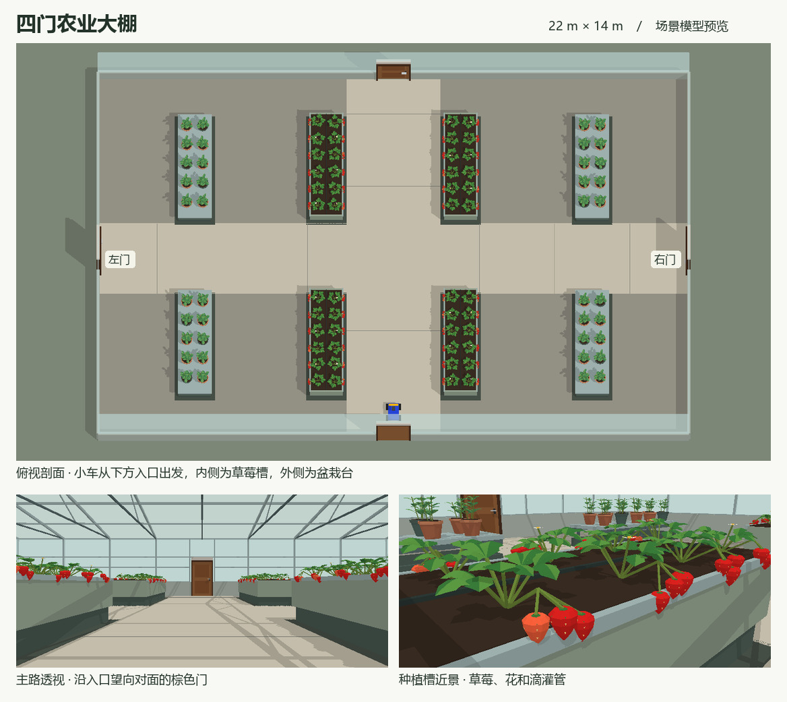

# RGB-D Mobile Robot Exploration

## 1. Development Environment

- Ubuntu 22.04
- ROS 2 Humble
- Gazebo Fortress
- Python 3
- OpenCV
- NumPy
- Open3D

## 2. Project Structure

- src/camera_processing: ROS 2 perception package
- worlds: Gazebo simulation worlds

## 3. Main Modules

- rgbd_subscriber.py: RGB-D processing and point cloud generation
- obstacle_clustering.py: DBSCAN obstacle clustering
- open3d_viewer.py: 3D point cloud visualization
- occ_mapping.py: Local occupancy grid mapping
- map_accumulator.py: Global occupancy grid mapping

## 4. Build

source /opt/ros/humble/setup.bash

cd ~/robot_ws

colcon build --packages-select camera_processing --symlink-install

source install/setup.bash

### 双房间建图

在 Ubuntu 图形桌面完成上述编译后运行：

```bash
ros2 launch camera_processing two_room_mapping.launch.py
```

场景随包安装。两间房共 8 m × 6 m，小车从西间原点朝 +X 出发。
正前方约 1.43 m 是隔墙，左前方是净宽 1.4 m 的门，东间有一个箱体。
启动后可以在 Gazebo 中观察小车的实际位置，并与三个感知窗口对照。

- **Gazebo** 显示双房间、门口、箱体和小车的运动。
- **Global OCC Map**：使用 Gazebo 车身位姿累积的二维地图（`/exploration/map`）。
- **RGB-D Local Occupancy Grid**：车头朝上的当前局部地图（`/rgbd_camera/occ_grid`）。
- **RGB-D 3D Obstacle Perception**：当前相机视野内的地面（灰色）和障碍物（红色）点云。

双房间使用 5 Hz 深度观测；场景为平地，相机水平安装，距地 0.78 m。
三维窗口按帧刷新，全局 OCC 在车辆移动时逐步积累。可从另一个已加载工作区环境的终端
手动给 `/model/mobile_robot/cmd_vel` 发送速度指令。先观察正前方隔墙，再慢速左转看门口，
转回时检查同一段墙在全局图里是否重合。用 Ctrl+C 结束 launch。

### 从入口出发，按文字指令在门前停车

四门场景是前后 14 米、左右 22 米的农业大棚。车从入口内侧 1 米出发，面向对面的门。两侧靠主路共四组高架草莓槽，外侧共四组盆栽台，中间的十字通道连接四边中央的棕色门。主路铺面宽 3.5 米，横路铺面宽 2.72 米。四扇门保持关闭，停车距离从车体中心量到门板，指令方位以入口处的车头为准。



大棚的全局占据图覆盖 16 × 24 米，分辨率为 0.05 米。棚架、棚膜和作物模型随包安装。修改作物或棚架造型后，可在仓库根目录运行 `python tools/build_greenhouse_meshes.py` 重新导出网格。

Windows 用 VMware 虚拟网卡地址启动 D 盘的模型服务。以下示例使用宿主机 VMnet8 的地址。Ubuntu 先检查模型列表，再启动仿真。

```bash
curl --noproxy '*' --max-time 5 http://192.168.19.1:18080/v1/models
ros2 launch camera_processing two_room_mapping.launch.py world:=four_doors.sdf vlm_server:=http://192.168.19.1:18080
```

在另一个已加载工作区环境的终端运行 `ros2 run camera_processing door_console`，输入一条任务，例如

```text
以0.12米/秒去对面的门，在门前1.2米停下
去对面的棕色门，在门前1米停下
去左边的门，在门前1米停下
去右边的门，在门前0.8米停下
```

任务内可单独输入“速度改为0.08米/秒”。这是前进线速度上限，可选范围为 0.05～0.30 米/秒，新任务默认 0.16 米/秒。转向、取图和停车仍由控制器处理。搜索路线的橙色终点为规划时选中的可达 frontier；接近已识别的门时则显示门前停车点。

Qwen 先在整幅 RGB 图里框出最清楚的一扇门。程序保留框边少量背景，把小框等比例放大，再请 Qwen 判断框内物体是房门、柜子、箱子还是其他物体。分类提示已包含门板、边框、把手和棕色线索，指令中可以省略颜色。日志出现“RGB 已确认房门”，表示两次视觉判断已完成。随后程序才在原始对齐深度图上取样，检查门面朝向并估计位置。远处的门即使能看清，也可能暂时超出可测距离。

四门仿真的门板都是棕色。分类为房门后，程序在同一组像素核对门板颜色和深度，至少半数采样点需要符合外观。两个不同视角给出的门位相距不超过 0.65 米时，程序锁定门的位置。远处尚缺可达路线时，车只选择能缩短到停车点距离的 frontier。进入停车点周围 1 米后，重试限于门前的已知可行区域。

车体进入指令距离的 ±0.14 米、横向偏差不超过 0.22 米时，小车刹停并对准门。它将锁定的门面投影到新的 RGB-D 帧，在 45 个位置核对门板颜色和深度。至少 32 个采样与锁定门面相差不超过 0.10 米且符合棕色，再用实测距离判断到达。转向造成的小幅前后偏移可沿已知畅通的栅格低速修正。看到 `Arrived` 表示已经复核成功，`Holding` 表示停车等待，可以在日志里查看原因。

launch 终端的 `[门观测 N]` 显示每帧的位姿、定位和分类原答、深度检查及导航决定。`/door/observation_image` 发布送检的原始 RGB 帧。搜索行驶和转向时，后台每完成一次推理就取最新同步 RGB-D 帧，按拍摄时间匹配位姿。忙碌期间跳过中间帧，运动控制继续运行，通过门位校验后转入停车规划，到达后静止复核。

每次启动四门文字导航，运行仿真的 Ubuntu 会在 `~/door_nav_logs/` 新建一个 HTML。启动时和节点正常退出时，launch 终端都打印完整路径。日志逐条写入，按 Ctrl+C 之前已经写入的整帧、复核局部图和判定都可以查看。退出文字指令终端也会显示日志目录。在 Ubuntu 运行以下命令，第一项就是最近写入的日志。

```bash
ls -lt ~/door_nav_logs/door_*.html
xdg-open ~/door_nav_logs/
```

Windows 的 `D:\Qwen3-VL-2B\Start-Qwen-VMnet8.cmd` 随模型启动日志接收端。使用该 Windows 模型地址时，Ubuntu 自动把当前日志的新增内容同步到 `D:\Qwen3-VL-2B\door_nav_logs\`。短时断开会在运行中续传。也可在 Ubuntu 浏览器打开 `http://192.168.19.1:18081/`，选取已有的 HTML 补传。接收脚本的版本保存在 `src/camera_processing/camera_processing/door_log_sync.py`。

省略距离时取 1 米，可指定 0.7 至 3 米。输入“停车”取消当前任务，也可以直接输入新任务。四门模式在若干特定方向取图，把 RGB 交给 Qwen，并用同一时刻的深度和车身位姿估计门的位置。未见门时在已知可行区域内用 A* 接近指令方向的 frontier；到门前后面向门重新观察。模型服务不可用时停车，并在 launch 终端报告原因。用 `ros2 topic echo /exploration/status` 可以查看后续状态变化。

### 在窄通道大棚里用自然语言在线探索

找出口时，小车优先从有转向余量的位置观察。深度图给出两侧边缘和中间净宽，Qwen 用包含门框、门扇的画面复核；单独看到门板时会尝试换视角。确认两帧的位置和朝向一致后才执行穿门。净空保护触发时立即制动，HTML 日志附上车位、局部与全局触发来源及全局占据栅格截图；持续有障碍时停车。

例如「以0.3米/秒的速度行驶，先左拐，遇到第一条作物行就进去巡一趟，走不通就退回来，再从右门出去」。单独的速度短语只设置上限。行间巡检记住实测行口：完成闭环，或补看两侧并确认行末封堵、沿车迹退回同一行口，均可继续下一步。单纯缺少可行路径不能证明封堵。明确要求「绕一圈」仍需轨迹形成闭环。

`greenhouse_routes.sdf` 包含草莓、生菜、盆栽、行间窄道和两处死胡同。四个方向都有门，右门打开，可以实际驶出。其余三扇关闭，可以观察并停靠。小车在入口记录第一帧里程计的朝向，作为本轮所有「左、右、前、后」的基准。新指令从小车当前位置开始。

1. 在 Windows 结束占用 18080 端口的旧模型窗口，双击 `D:\Qwen3-VL-2B\Start-Qwen-Greenhouse.cmd`，等它显示模型已加载。启动脚本的副本在仓库 `tools/` 下，使用已有本地 Qwen 权重和日志接收端。Ubuntu 终端一运行以下命令。

   ```bash
   cd ~/robot_ws
   git switch codex/two-room-mapping
   git pull --ff-only
   git log -1 --oneline
   source /opt/ros/humble/setup.bash
   colcon build --packages-select camera_processing --symlink-install
   source install/setup.bash
   ros2 launch camera_processing two_room_mapping.launch.py world:=greenhouse_routes.sdf vlm_server:=http://192.168.19.1:18080
   ```

2. 在 Ubuntu 终端二打开指令输入。

   ```bash
   cd ~/robot_ws
   source install/setup.bash
   ros2 run camera_processing route_console
   ```

3. 在终端二输入自己的指令。「先左拐」会在当前位置转向入口左侧。「经过第一个十字路口左拐，然后前面遇到第一条作物行进去走一圈，然后从大棚的右门出」会先沿当前道路观察，确认路口才转弯。「去左边的门停留两秒后返航到原来的入口」会先找门、停靠、等待，再返回入口。途中输入「停车」可取消任务。

Qwen 将原话拆为有顺序的动作。程序核对原文中的方位、序号、距离、速度和等待时间。模型给出动作意图，地标坐标来自运行中的 OCC、RGB-D 和里程计。十字路口需要看到四个通行方向。作物行需要看到行间通道和旁边的植株。序号按沿途实际确认的不同地点计数。绕行要在实测轨迹中环绕植株并回到原行口。出门要先验证门洞有净宽，再以连续位姿核实穿过门槛。现场尚未核实下一项时，日志会说明停在哪一步。

「找个门」可以确认任意方向的门，「去门前」默认在约 1 米处复核停车。可以说「以每秒十五厘米往前走半米，等两秒，再回入口」，速度上限支持 0.05～0.30 米/秒。观察会记录画面描述，拍照会把当时的 RGB 帧写进 HTML。独立而无法执行的动作会标明跳过；遇到「如果有虫就拍照」等缺少可靠判定能力的条件，会停在该条件并说明原因。当前路口和绕行技能针对近似直角的种植行。

全局图的紫线是实测车迹，绿线是当前阶段已观测可通行区域中的短路径。终端和 HTML 记录原话、模型返回、逐步执行结果、位置和视觉证据。Ubuntu 日志位于 `~/door_nav_logs/`，Windows 接收目录为 `D:\Qwen3-VL-2B\door_nav_logs\`。也可用以下命令单独预览语言解析，小车将保持原位。

```bash
ros2 run camera_processing route_console --preview '第一个十字路口左转，然后沿第一条作物行走一圈，然后从右门出去' --server http://192.168.19.1:18080
```

### 自主探索双房间

在 Ubuntu 上编译并加载工作区后，先用 Ctrl+C 结束上一轮仿真，再启动自主模式。
同一轮仿真只启动一个 launch，自主运行期间由探索节点独占速度指令。

```bash
ros2 launch camera_processing two_room_mapping.launch.py explore:=true
```

小车等待全局地图、局部 OCC 和车身位姿，随后原地转一圈。算法从观测到的自由格中寻找与未知区相邻的
连通边界组，在已知自由空间内用 A* 选路。障碍物的规划膨胀半径为 0.55 m。
车身起点若落在膨胀边缘的已知自由格，允许从起点接入紧邻的可行格；
对角移动需要两侧均可通行。规划只使用在线地图。

在 **Global OCC Map** 中，蓝色箭头表示小车，绿色折线表示最近一次规划的路径，
橙色圆点表示当前目标。小车以最高 0.16 m/s 跟踪路径，到达观察位置后再扫描。
跟踪时车头与前视点的方向误差收敛到约 7° 才前进。慢速对准期间，朝向误差持续减小也计作进展。
路径失效时重新规划，局部图检测到前方受阻或跟踪停滞时尝试其他目标。
地图或里程计超过 1.2 秒仿真时间未更新时，控制器发零速度并等待恢复。

终端显示 `Complete` 表示补扫后仍未找到符合条件的可达边界；
`Blocked` 表示净空不足、原地扫描卡住或剩余目标重试失败。两种状态都会停车。
Ctrl+C 结束整轮实验。省略 `explore:=true` 可进入手动建图模式。

### 核对原地旋转与扫描结果

双房间的四个轮子按左右两侧差速驱动，车头的黄色条标记底盘 +X。
建图和控制使用 Gazebo 提供的车身世界位姿作为仿真定位输入，两间房内的墙和障碍仍由深度相机观测。
原有轮速里程计独立发布，便于区分轮子运动和车身运动。

在新的仿真中启动探索，观察黄条是否随车身转动。终端的 `Scan:` 行每三秒给出累计转角、
最大平面位移、车身角速度（`pose`）和轮速推算的角速度（`wheels`）。
启动时的 `Explorer source SHA256` 显示正在加载的探索节点文件路径及其校验值前 12 位。
在 Ubuntu 工作区根目录运行 `git show HEAD:src/camera_processing/camera_processing/frontier_explorer.py | sha256sum`
即可与当前提交中的节点源码核对。
扫描按实际车身转角累计到 360°。四轮转向时旋转中心可能来回偏移，最大平移作为诊断值记录。
每次发旋转指令前都会检查局部观测和全局图中车身四周 0.42 m 的已知障碍。
只要净空足够、观测及时且车身持续转动，扫描就会继续。无角度进展时会停车。
全局图会显示整圈完成、等待新地图、跟踪或停车原因。
若日志显示 `No goal`，同一行给出当前连通的自由面积和与其相邻的候选边界格数，可与门口附近的地图对照。

## 5. Main Topics

- /rgbd_camera/depth_image
- /rgbd_camera/ground
- /rgbd_camera/obstacles
- /rgbd_camera/occ_grid
- /exploration/map
- /exploration/path
- /exploration/status
- /model/mobile_robot/cmd_vel
- /model/mobile_robot/odometry（车轮里程计）
- /model/mobile_robot/world_odometry（Gazebo 车身位姿，仅双房间仿真）
